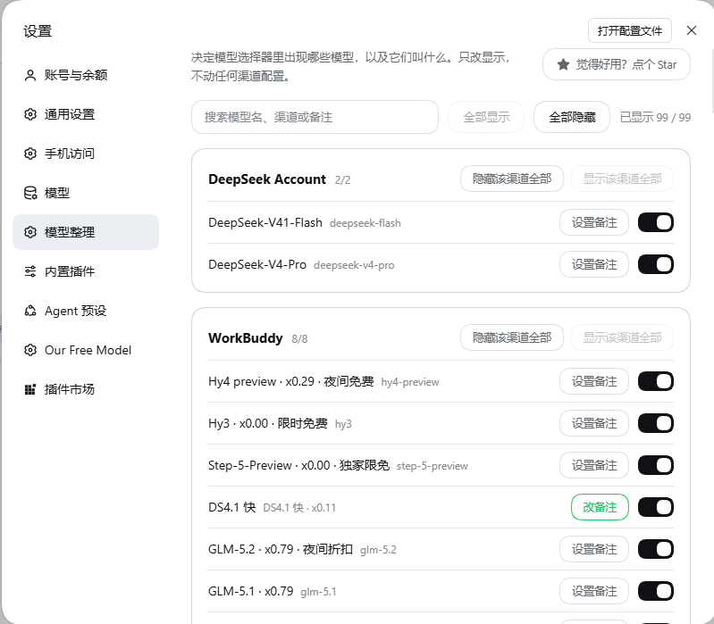

# dsh-model-tidy

[中文](README.md) · [English](README.en.md) · **日本語** · [Русский](README.ru.md)

DeepSeek Harness のモデル選択メニューを整理するプラグインです。どのモデルを表示するかを選び、覚えやすい名前を付け、プロバイダーが表示名に付けている従量倍率を保ちます。



## 解決する問題

プロバイダーのプラグインを二つ三つ入れると、モデルメニューは壁になります。無料枠のレーン、作業用アプリ、自分で設定したゲートウェイ——気づけば三十項目。そのほとんどは選ぶことのないモデルで、いくつかは同じモデルが別の経路で重複しています。

モデル選択は**意思決定の場であって、在庫一覧ではありません**。実際に使ういくつかだけを、見覚えのある名前で並べるべきです。

## できること

インストールすると、DSH の設定に「**モデル整理**」セクションが追加されます。モデルは取得元のプロバイダーごとにまとまり、それぞれに一つのスイッチが付きます。

```
┌─ WorkBuddy ───────────────────────────── 8/12 ─ [全て隠す] [全て表示] ─┐
│  Auto                                            ●───                  │
│  GLM-5.3 · x0.79                                 ●───                  │
│  GLM-5.2 · x0.79 · 夜間割引          [別名]      ───●                  │
│  Grok-4.7 · x1.90                                ───●                  │
└────────────────────────────────────────────────────────────────────────┘
┌─ our-free-model ───────────────────────── 6/6 ── [全て隠す] [全て表示] ─┐
│  Kilo Auto Free                                  ●───                  │
└────────────────────────────────────────────────────────────────────────┘
```

- **モデルごとに一つのスイッチ** — オフにするとモデル選択メニューから消えます。
- **別名** — 覚えやすい名前を付けると、選択メニューはその名前で表示します。プロバイダーの従量倍率は末尾にそのまま残ります。
- **検索** — モデル名・プロバイダー・別名で絞り込めます。
- **プロバイダー単位の一括操作** — 一つのプロバイダーの全モデルをワンクリックで隠す／表示する。
- **全体の表示／非表示** — カタログ全体に対する二つのボタン。
- **復元** — 別名をすべて消すボタンと、全モデルを戻すボタン。

## 別名を付けても従量倍率は失われません

プロバイダーは従量倍率をモデルの**表示名**に付け足します——`GLM-5.3 · x0.79` のように。harness のモデルカタログに倍率のフィールドがないためです。この名前をそのまま置き換える（よくある別名の実装）と、倍率は黙って失われます。

本プラグインはプロバイダー自身の区切り文字で名前を分割し、後半を保ちます。

| | 選択メニューに表示される名前 |
|---|---|
| プロバイダーの元の名前 | `GLM-5.3 · x0.79` |
| 「GLM 安い」に別名変更 | **`GLM 安い · x0.79`** |
| セール表示付きで別名変更 | **`GLM 安い · x0.79 · 夜間割引`** |
| 倍率がないモデルを別名変更 | `自動` ← 余分な区切りは付かない |

## 隠してもモデルの位置は動きません

隠したモデルはカタログに存在しません（harness が取り除きます）。そのため行は保存された情報からしか復元できません。**素直に末尾へ追加すると、隠した瞬間にグループの一番下へ飛びます**。本プラグインは各行を最初に見た位置を覚えているので、五つのうち三つ目を隠しても三つ目のままです。

## 意図的にやらないこと

**整理は表示上の判断であり、設定の変更ではありません。**

- プロバイダーの設定は書き換えません。非表示リストと別名表は本プラグイン自身の設定名前空間にのみ存在します。
- 使用中のモデルを隠したり別名を変えても、そのセッションは動き続けます。経路はモデル ID で決まり、変わるのは表示名だけです。
- アンインストールすると元の一覧に完全に戻ります。
- プロバイダーが新しく提供し始めたモデルは既定で表示されます。本プラグインが記録するのは「何を隠すか」「何を改名するか」だけで、「何を表示するか」ではありません。

## 対象範囲

スイッチは**すべての**モデル取得元に効きます。手動設定のプロバイダーだけではありません。本プラグインが絞り込むのは harness 自身のカタログ列挙——`ctx.llm.listModels`——であり、これはすべての画面が読む唯一の一覧です。他のプラグインが `ctx.llm.registerAdapter` で登録したモデルも、`llm-pi-ai` で宣言されたプロバイダーも、同じ一覧に入るため対象になります。

行は **プロバイダー + モデル** をキーとするため、同じモデル名が二つの経路から来ても独立した二行のままです。`workbuddy/gemini-3.8-flash` と `gemini/gemini-3.8-flash` は別の上流サービスであり、それぞれにスイッチと別名があります。

## インストール

```sh
dsh plugin --profile <あなたの profile> add dsh-model-tidy
```

その後 DSH Web GUI を開き直すと、設定ナビゲーションに「**モデル整理**」が現れます。

## 開発

ビルド手順はありません。両Halfとも harness がそのまま読み込む素のファイルとして配布されます。ホスト側は ES モジュール、ブラウザー側は `window.__ModuleLoader__.load` ファクトリー——クライアントのモジュールシステムが呼ぶ形式です。

```sh
npm test
```

七つのスイートをまとめて実行します。カタログのフィルター、従量倍率の分割、ブラウザー側の挙動、別名の後尾の取り込み、行の並び順、描画ツリー、そして同じメソッドを包む別プラグインとの共存です。

`npm run check:packaging` は、クライアント依存の宣言が harness に実在するパッケージを指しているかを検証します。

## 互換性

DSH `0.2.0-rc.2` に対して開発しています。DSH `>= 0.2.0-rc.1` が必要です——このバージョンで設定層に `configForms` サービスが加わり、本プラグインのセクションはそれを通して書き込みます。

## ライセンス

MIT
